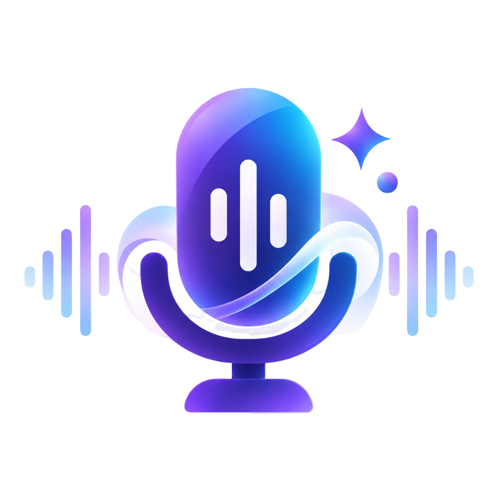
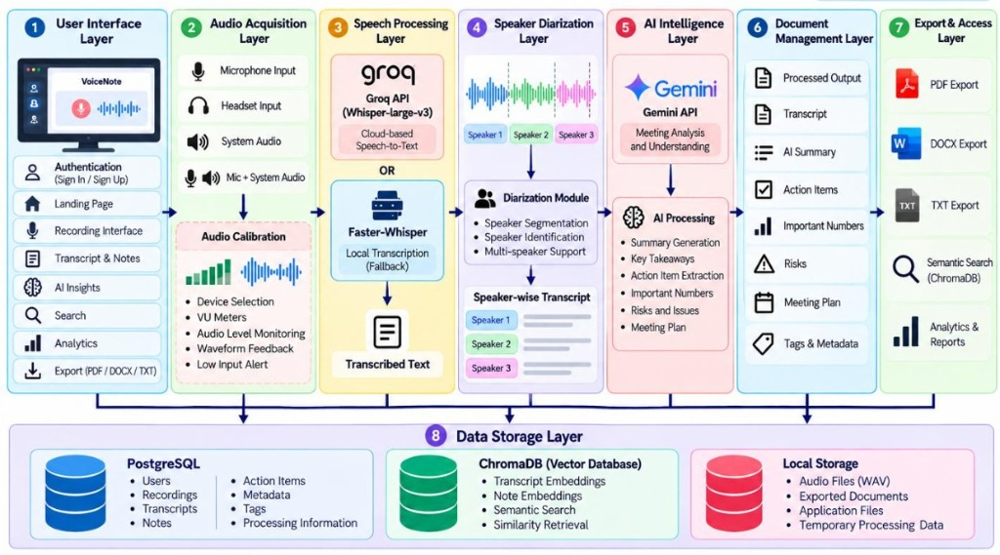
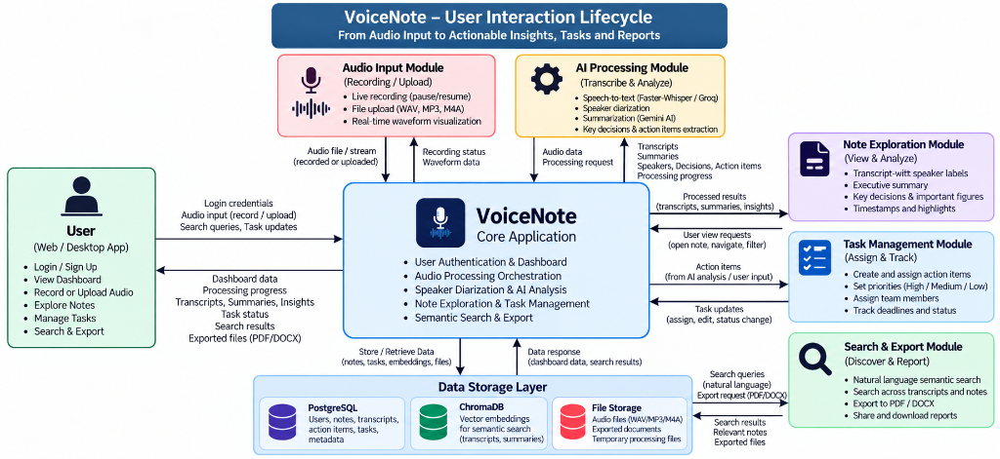
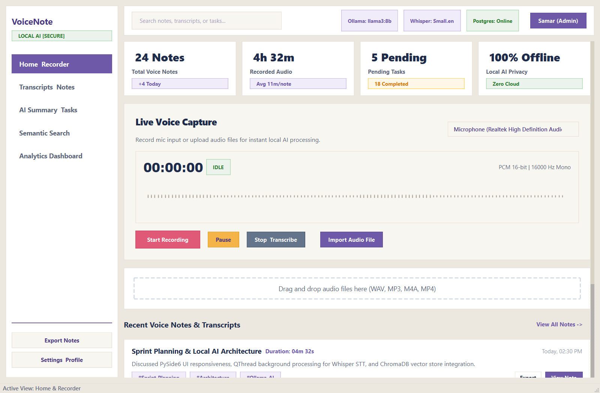
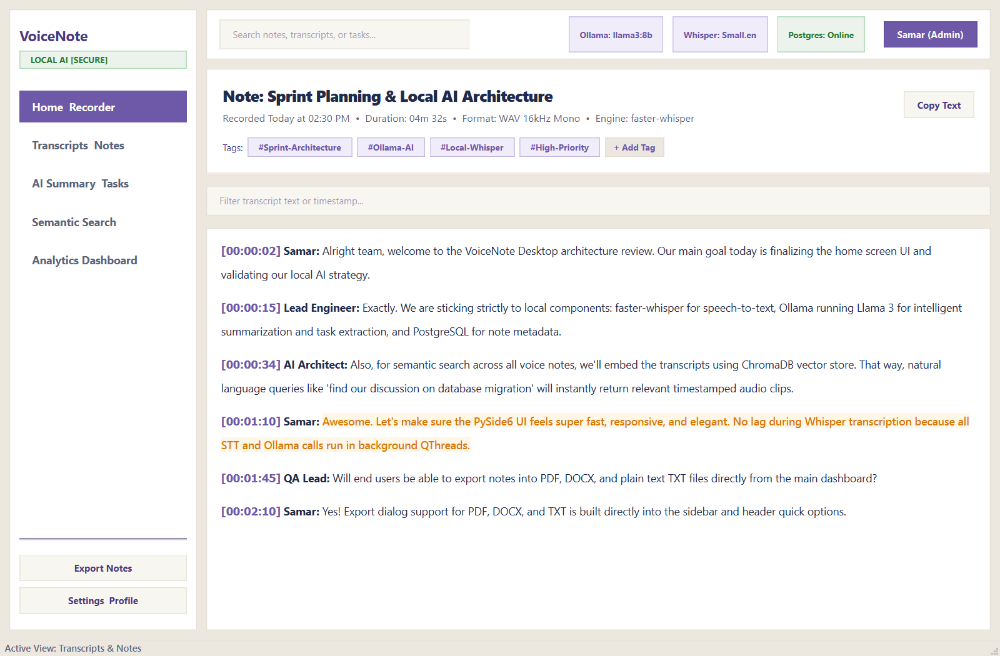
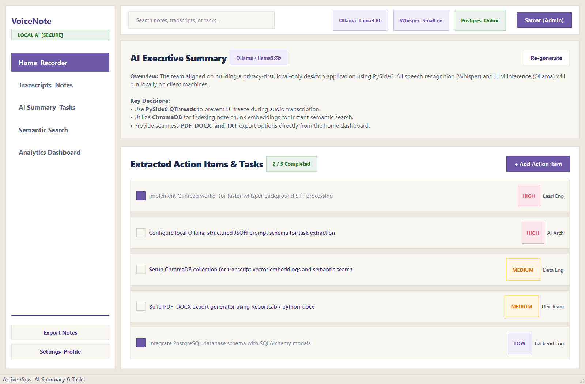
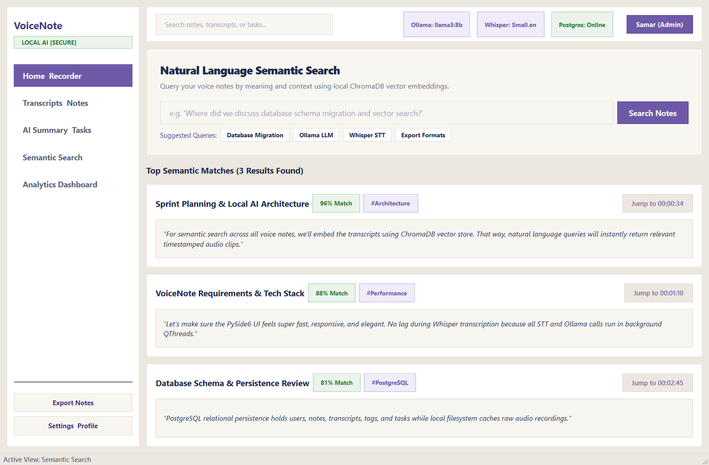
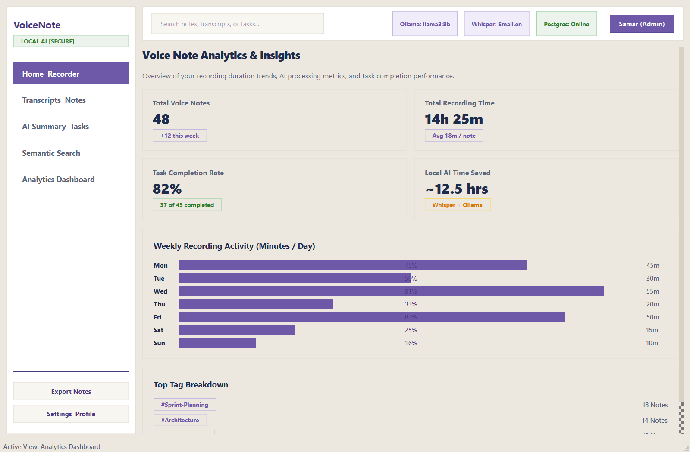

# VoiceNote Desktop — Enterprise Voice Intelligence System

<div align="center">



### *"LISTEN. UNDERSTAND. ORGANIZE. ACT."*

**A Privacy-First, Multilingual Desktop Intelligence Platform with Triple-Tier Hybrid Storage**

[](https://www.python.org/)
[-41CD52.svg)](https://wiki.qt.io/Qt_for_Python)
[](https://www.postgresql.org/)
[](https://www.trychroma.com/)
[](https://github.com/SYSTRAN/faster-whisper)
[](https://ai.google.dev/)
[-0078D6.svg)](https://www.microsoft.com/windows)
[](run_all_tests.py)

[Features](#-core-features) •
[System Architecture](#-system-architecture) •
[Interaction Lifecycle](#-user-interaction-lifecycle) •
[Screen Tour](#-production-screen-tour) •
[Tech Stack](#-technical-specifications) •
[Quickstart](#-installation--quickstart-guide) •
[Team](#-engineering-team--module-ownership)

---

</div>

## 📌 Executive Summary & Project Vision

**VoiceNote Desktop** is an enterprise-grade, privacy-centric voice intelligence platform built specifically for Windows desktop environments. It bridges the gap between unstructured vocal communication (meetings, board conferences, technical standups, and voice notes) and actionable productivity.

VoiceNote captures dialogue from physical microphones and internal computer sound (via **Windows WASAPI System Loopback** for Zoom, Microsoft Teams, and Google Meet without requiring meeting bots), transcribes multi-speaker audio across English, Hindi, and Marathi, performs speaker diarization, generates executive summaries, extracts actionable deliverables with assigned owners and due dates, and indexes every utterance into a local vector database for sub-second semantic retrieval.

---

## 🏛️ System Architecture

VoiceNote implements a high-performance **8-Layer Architecture** designed to keep the desktop user interface completely fluid at 60 FPS while background workers execute computationally intensive speech recognition, vector indexing, and generative AI analysis:

<div align="center">



</div>

### Architectural Layers:
1. **User Interface Layer**: Native PySide6 (Qt6) interface styled with a custom Bento Grid and Retro Warm Cream design system.
2. **Audio Acquisition Layer**: Captures physical microphones, USB headsets, and internal system audio (WASAPI Loopback) with real-time dBFS and RMS telemetry.
3. **Speech Processing Layer**: Dual-engine transcription using local **Faster-Whisper** (CTranslate2 int8) with cloud fallback to **Groq API** (`whisper-large-v3`).
4. **Speaker Diarization Layer**: Acoustic pause detection and turn segmentation attributing utterances to distinct speaker labels (`Speaker 1`, `Speaker 2`, etc.).
5. **AI Intelligence Layer**: Generative analysis via **Google GenAI (Gemini 3.8 Flash)** with a resilient fallback ladder (`3.8-flash` ➔ `2.5-flash` ➔ `2.0-flash` ➔ `1.5-flash`).
6. **Document Management Layer**: Structured intelligence extraction (Executive Summaries, Key Decisions, Action Items, Deadlines, and Numbers).
7. **Export & Access Layer**: Multi-format document compilation (ReportLab PDF with embedded Noto Sans Devanagari fonts, Microsoft Word `.docx`, and plaintext `.txt`).
8. **Triple-Tier Data Storage Layer**:
   - **PostgreSQL 14+**: ACID relational metadata, note records, transcripts, and cascading task boards.
   - **ChromaDB**: 384-dimensional dense text embeddings (`all-MiniLM-L6-v2`) with an HNSW index for natural language semantic search.
   - **Local File System**: Raw 16 kHz 16-bit Mono PCM `.wav` audio files in `data/recording/`.

---

## 🔄 User Interaction Lifecycle

The end-to-end lifecycle illustrates how audio transitions from raw acoustic signals into structured knowledge, action items, and searchable reports:

<div align="center">



</div>

---

## 🚀 Core Features

* 🎙️ **Dual-Source Audio Capture & Loopback**: Seamlessly record physical microphone input, system audio (capturing internal sound from Teams/Zoom/Meet directly without external room echo), or both simultaneously.
* 📊 **Real-Time dBFS Calibration**: High-precision VU meter (calibrated from $-60\text{ dBFS}$ noise floor to $0\text{ dBFS}$ peak) with 60 FPS animated QPainter `WaveformWidget`.
* 🗣️ **Multilingual & Indic Devanagari Polish**: Specialized prompt engineering and Gemini `TranscriptCorrector` to resolve Whisper translation drift and preserve authentic Marathi and Hindi grammar and Indian currency (`₹`).
* 👥 **Acoustic Speaker Diarization**: Multi-speaker turn segmentation with color-coded dialogue bubbles and millisecond timestamps.
* 🧠 **Pydantic-Validated Meeting Intelligence**: Gemini 3.8 Flash extracts executive narrative summaries, key decisions, project risks, important numbers, and deliverables with urgency ratings (`HIGH`, `MEDIUM`, `LOW`).
* 🔍 **ChromaDB Sub-Second Semantic Search**: Conceptual search matching meaning and intent rather than literal keywords with ranked cosine relevance percentages (`96% Match`).
* 📄 **Multi-Format Export Engine**: One-click generation of professional PDF meeting minutes (with embedded Devanagari typography), Word `.docx` documents, and plaintext files.
* 📈 **Productivity Analytics Dashboard**: Visual graphs tracking weekly recording trends, task completion velocity, and estimated hours saved by AI automation.

---

## 🖥️ Production Screen Tour

### 1. Home Dashboard & Live Audio Calibration
*Dual-source recording selection, real-time dBFS level monitoring, waveform visualization, and live session counters.*


---

### 2. Multi-Speaker Diarized Transcripts
*Color-coded speaker dialogue turns with millisecond timestamp seeking and Devanagari script support.*


---

### 3. AI Executive Summary & Action Board
*Structured meeting synthesis, key decisions, and interactive task board with assignees and due dates.*


---

### 4. ChromaDB Sub-Second Semantic Search
*Natural language conceptual retrieval across all notes with ranked similarity match badges.*


---

### 5. Productivity Analytics & Insights Dashboard
*Weekly recording trends, task velocity metrics, and quantified time-saved calculations.*


---

## ⚙️ Technical Specifications

### Audio Pipeline Parameters
* **Capture Format**: Linear Uncompressed PCM (WAV)
* **Sampling Rate ($f_s$)**: $16,000\text{ Hz (16 kHz)}$
* **Bit Depth**: $16\text{-bit Signed Integer (int16)}$
* **Channel Configuration**: $1\text{ (Mono)}$
* **Bitrate**: $256\text{ kbps} = 32\text{ KB/second}$
* **Storage Consumption**: $1.875\text{ MB/minute} \approx 112.5\text{ MB/hour}$

### Empirical Processing Latency (Real-Time Factor Benchmarks)

$$\text{RTF} = \frac{\text{Processing Duration}}{\text{Audio Duration}}$$

| Audio Duration | WAV File Size | Local Mode (Faster-Whisper int8) | Cloud Mode (Groq whisper-large-v3) | Post-Processing (LLM + Vector) | Total Turnaround Time |
| :---: | :---: | :---: | :---: | :---: | :---: |
| **1 Minute** | $1.875\text{ MB}$ | $\approx 9 - 14\text{ s}$ | $\approx 1.5 - 2.5\text{ s}$ | $\approx 2.5\text{ s}$ | **$\approx 15\text{s}$ (Local) / $\approx 4.5\text{s}$ (Cloud)** |
| **2 Minutes**| $3.75\text{ MB}$ | $\approx 18 - 25\text{ s}$ | $\approx 2.8 - 4.0\text{ s}$ | $\approx 3.0\text{ s}$ | **$\approx 25\text{s}$ (Local) / $\approx 6.5\text{s}$ (Cloud)** |
| **5 Minutes**| $9.375\text{ MB}$ | $\approx 45 - 60\text{ s}$ | $\approx 6.0 - 8.5\text{ s}$ | $\approx 4.0\text{ s}$ | **$\approx 55\text{s}$ (Local) / $\approx 11.5\text{s}$ (Cloud)** |
| **10 Minutes**| $18.75\text{ MB}$ | $\approx 90 - 130\text{ s}$ | $\approx 12 - 18\text{ s}$ | $\approx 5.5\text{ s}$ | **$\approx 115\text{s}$ (Local) / $\approx 20.0\text{s}$ (Cloud)** |

---

## 🛠️ Installation & Quickstart Guide

### 1. Prerequisites
* **Operating System**: Windows 10 or Windows 11 (64-bit)
* **Python**: Version `3.11` or higher
* **PostgreSQL**: Version `14+` running locally or accessible via network

### 2. Clone & Environment Setup
```powershell
# Clone the repository
git clone https://github.com/Samar-365/VoiceNote.git
cd VoiceNote

# Create and activate virtual environment
python -m venv .venv
.venv\Scripts\activate

# Install dependencies
pip install -r requirements.txt
```

### 3. Configure Environment Variables (`.env`)
Create a `.env` file in the project root:
```env
# Application Settings
APP_NAME=VoiceNote
VERSION=0.1.0

# Database Configuration (PostgreSQL 14+)
DB_ENGINE=postgres
POSTGRES_HOST=localhost
POSTGRES_PORT=5432
POSTGRES_DB=voicenote
POSTGRES_USER=postgres
POSTGRES_PASSWORD=your_postgres_password_here

# AI & Cloud STT API Keys
GEMINI_API_KEY=your_gemini_api_key_here
GEMINI_MODEL=gemini-3.8-flash

GROQ_API_KEY=your_groq_api_key_here
GROQ_STT_MODEL=whisper-large-v3
LOCAL_STT_MODEL=small
```

### 4. Run Automated Quality Gate
Verify that all 9 subsystems pass before launching:
```powershell
python run_all_tests.py
```

### 5. Launch Application
```powershell
python main.py
```

*Default Demo Credentials*:
* **Username**: `admin`
* **Password**: `admin123`

---

## 🧪 Automated Testing & Verification Gate

VoiceNote enforces a **9-module automated verification gate** in `run_all_tests.py` ensuring zero regressions across all core engines:

```powershell
============================================================
           VOICENOTE TEST SUITE (9 MODULES)
============================================================
[1/9] Testing PostgreSQL Database Connection & Models...   [PASS]
[2/9] Testing Text Cleaner Utility...                      [PASS]
[3/9] Testing Audio Engine WAV Serialization...            [PASS]
[4/9] Testing Gemini AI Engine & JSON Schemas...           [PASS]
[5/9] Testing ReportLab & DOCX Export Engine...            [PASS]
[6/9] Testing Analytics Engine Metric Computations...      [PASS]
[7/9] Testing ChromaDB Vector Engine & Cosine Queries...   [PASS]
[8/9] Testing User Authentication & SHA-256 Hashing...     [PASS]
[9/9] Testing PySide6 UI Component Initialization...       [PASS]
------------------------------------------------------------
Overall Result: 9/9 PASSED (100% Quality Verification)
============================================================
```

---

## 👥 Engineering Team & Module Ownership

| Team Member | Engineering Role | Core Subsystems & Architectural Contributions |
| :--- | :--- | :--- |
| **Tejas Rawool** (`@admin`) | **System Architect & Backend Lead** | PostgreSQL persistence layer, ChromaDB vector engine, multi-tier fallback Gemini LLM integration, live audio RMS/dBFS telemetry calibration, Marathi Devanagari `TranscriptCorrector`, cascading deletions, and unified 9-module test suite. |
| **Samar Shetye** | **UI/UX Lead & Presentation Architect** | PySide6 Bento Grid & Retro Warm Cream design system, `WaveformWidget`, `AudioRecorderWidget`, `TranscriptViewWidget`, `SummaryTaskWidget`, ReportLab PDF (with embedded Indic fonts), DOCX `ExportEngine`, and user authentication dialog. |
| **Atharv Pavar** | **AI & Machine Learning Lead** | Initial Faster-Whisper and Groq Cloud STT integration, prompt engineering for meeting intelligence, structured JSON schemas, Pydantic validation models, and Speaker Diarization turn segmentation engine. |

* **Project Guide**: **Prof. Omkar Dike**
* **Institution**: B.E. Information Technology • Open Source Project Lab (Semester VII)

---

## 📄 License & Intellectual Property

This project is licensed under the **MIT License**. All rights reserved. Built with open-source technologies for privacy-centric enterprise intelligence.
