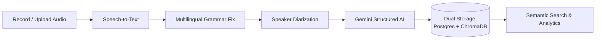
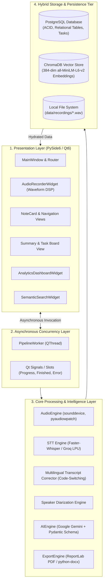
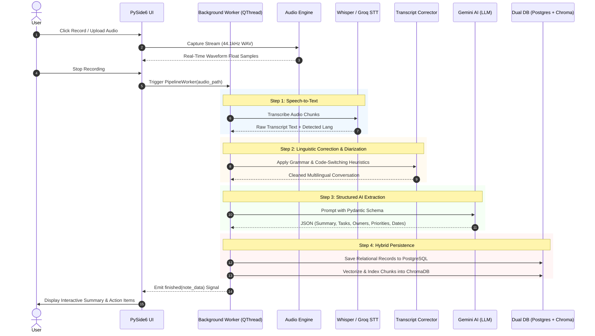
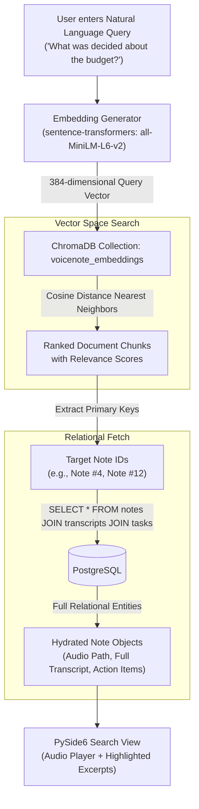

# VoiceNote: Intelligent Desktop Audio Intelligence & Semantic Retrieval System

[](https://www.python.org/)
[](https://doc.qt.io/qtforpython/)
[](https://www.postgresql.org/)
[](https://www.trychroma.com/)
[](https://ai.google.dev/)
[](https://github.com/SYSTRAN/faster-whisper)

**VoiceNote** is a privacy-first, offline-capable Windows desktop application designed to transform spoken meetings, lectures, and voice memos into structured, searchable intelligence. It features live audio waveform capture, multilingual transcription with specialized Marathi/Hindi code-switching correction, automated speaker diarization, AI-driven action item extraction, and natural language semantic retrieval powered by a hybrid dual-database architecture.

---

## Simple Workflow Diagram

How a recording turns into actionable knowledge:



### Step-by-Step User Journey:
1. **Capture**: Speak into the microphone with a real-time 60 FPS waveform display, or upload any `.wav`, `.mp3`, or `.m4a` recording.
2. **Transcribe**: Audio is processed locally via `faster-whisper` (offline) or accelerated via `Groq LPU` (cloud).
3. **Correct & Diarize**: Proprietary linguistic rules fix Indian multilingual code-switching (e.g. Marathi verbs confused with Hindi), strip distracting timestamps, and assign persistent speaker color tags.
4. **Extract Intelligence**: Google Gemini models map conversational transcripts into rigid Pydantic schemas: Executive Summaries, Action Items (Assignee, Priority, Due Date), Key Decisions, and Numbers.
5. **Store & Retrieve**: Relational data commits to **PostgreSQL**, while dense vector embeddings index into **ChromaDB** for instant natural language semantic retrieval.

---

## Key Features

- **Real-Time Waveform & Studio Audio Capture**: High-fidelity recording with live Decibel (dBFS) normalization using `sounddevice` and Windows WASAPI loopback support.
- **Dual-Engine Speech Recognition**: Offline-first via `faster-whisper` (CTranslate2 8-bit quantized) with zero cloud dependency, plus instant cloud inference via Groq `whisper-large-v3`.
- **Multilingual Code-Switching Corrector**: Solves Whisper's known degradation with regional languages (Marathi/Hindi mixed with English), restoring proper Devanagari grammar and undoing spontaneous mistranslations.
- **Speaker Diarization & Script Formatting**: Distinguishes multiple voices, merges contiguous dialogue into natural paragraphs, and strips noisy timestamp clutter.
- **Actionable Task & Decision Extraction**: Automatically extracts tasks with assignees, priorities, and deadlines, directly populated into an interactive task board.
- **Semantic Vector Search (RAG-Ready)**: Ask natural language questions like *"What did we decide about the budget?"* and retrieve matching notes based on conceptual meaning, not just exact keywords.
- **Real Data Analytics Dashboard**: 100% computed metrics: speaker talk-time distribution, sentiment analysis, task completion ratios, and recording trends over 7/30/90 days.
- **Multi-Format Document Export**: One-click generation of professional PDF reports (via ReportLab) and editable Microsoft Word documents (`.docx`).

---

## System Architecture

### 1. High-Level Layered Architecture



---

### 2. End-to-End Processing Pipeline (Audio to Insight)



---

### 3. Hybrid Dual-Database & Semantic Search RAG Flow



---

### 4. PostgreSQL Relational Database Schema (ER Diagram)


---

## Technology Stack Breakdown

| Layer | Primary Technology | Purpose |
| :--- | :--- | :--- |
| **Frontend UI** | **PySide6 (Qt 6 for Python)** | Native desktop UI, 60 FPS waveform visualization, responsive layouts |
| **Concurrency** | **Qt QThread, Signal & Slot** | Non-blocking background worker pipeline |
| **Audio DSP** | **sounddevice, soundfile, pyaudiowpatch, numpy** | Audio capture, loopback recording, and real-time amplitude normalization |
| **Speech-to-Text (STT)** | **faster-whisper (CTranslate2) & Groq** | Local offline transcription & high-speed cloud STT |
| **AI & NLP** | **Google Gemini (google-genai) + Pydantic v2** | Structured summarization, task extraction, and linguistic error correction |
| **Relational Database** | **PostgreSQL (psycopg2-binary)** | ACID-compliant structured metadata, transcripts, and relational task tracking |
| **Vector Database** | **ChromaDB + sentence-transformers (all-MiniLM-L6-v2)** | 384-dimensional dense vector embeddings for cosine semantic retrieval |
| **Document Export** | **ReportLab & python-docx** | Formatted export to PDF, Word DOCX, and plain text |

---

## Repository Structure

```text
VoiceNote/
├── doc/                        # Architectural specifications and SRS documentation
│   ├── architecture.md         # Detailed dual-database and storage architecture
│   ├── database-setup.md       # PostgreSQL schema setup instructions
│   └── srs.md                  # Software Requirements Specification
├── voicenote/                  # Core application package
│   ├── config.py               # Central configuration, paths, and environment settings
│   ├── core/                   # Algorithmic and processing engines
│   │   ├── ai_engine.py            # Gemini integration and Pydantic schema validation
│   │   ├── analytics_engine.py     # Aggregation and metric computations
│   │   ├── audio_engine.py         # Audio capture, recording, and playback
│   │   ├── diarization_engine.py   # Speaker separation and conversation structuring
│   │   ├── export_engine.py        # PDF and Word DOCX document generation
│   │   ├── groq_stt_engine.py      # Cloud Whisper on Groq LPU
│   │   ├── stt_engine.py           # Local faster-whisper engine
│   │   ├── text_cleaner.py         # Text whitespace and symbol normalization
│   │   ├── transcript_corrector.py # Multilingual regional grammar & code-switch correction
│   │   └── vector_engine.py        # ChromaDB indexing and cosine search
│   ├── db/                     # Database access layer
│   │   ├── database.py             # PostgreSQL connection and CRUD operations
│   │   └── models.py               # Data models for notes, transcripts, summaries, and tasks
│   ├── services/               # Background task orchestration
│   │   └── worker.py               # Asynchronous QThread pipeline worker
│   └── ui/                     # PySide6 desktop user interface
│       ├── components/             # Reusable widgets (Waveform, Taskboard, Search, Analytics)
│       ├── dialogs/                # Modals (Login, Settings, Profile, Export)
│       ├── main_window.py          # Main application window & navigation controller
│       └── styles.py               # Custom retro-cream stylesheet tokens
├── data/                       # Local recordings and generated artifacts
├── main.py                     # Application entry point with session management
├── requirements.txt            # Python dependencies
└── run_all_tests.py            # Automated test runner suite
```

---

## Getting Started

### 1. Prerequisites
- **Python 3.11+** installed
- **PostgreSQL 14+** running locally or remotely

### 2. Installation
Clone the repository and set up a virtual environment:

```bash
git clone https://github.com/Samar-365/VoiceNote.git
cd VoiceNote

python -m venv .venv
# On Windows:
.venv\Scripts\activate
# On Linux / macOS:
source .venv/bin/activate

pip install -r requirements.txt
```

### 3. Environment Configuration
Create a `.env` file from the example template:

```bash
cp .env.example .env
```

Update your `.env` with your API keys and database credentials:
```env
GEMINI_API_KEY=your_gemini_api_key_here
GROQ_API_KEY=your_groq_api_key_here

DB_ENGINE=postgres
POSTGRES_HOST=localhost
POSTGRES_PORT=5432
POSTGRES_DB=voicenote
POSTGRES_USER=postgres
POSTGRES_PASSWORD=your_password
```

### 4. Database Setup
Ensure your PostgreSQL database exists:
```sql
CREATE DATABASE voicenote;
```
*(The application will automatically initialize the tables upon first run).*

### 5. Launch Application
```bash
python main.py
```

### 6. Run Test Suite
To verify database persistence, the multilingual cleaner, and the AI pipeline:
```bash
python run_all_tests.py
```
