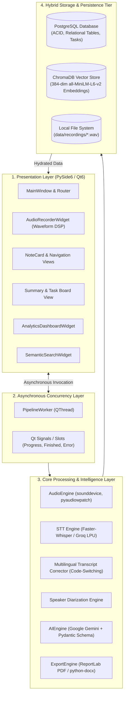
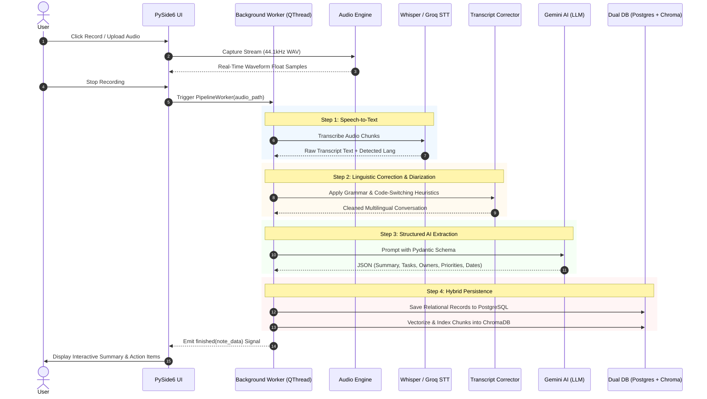
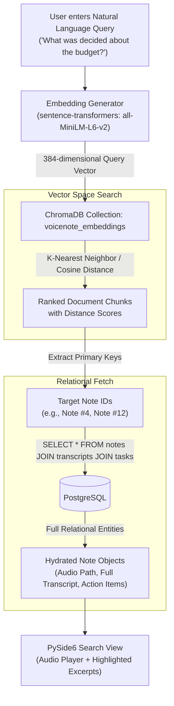
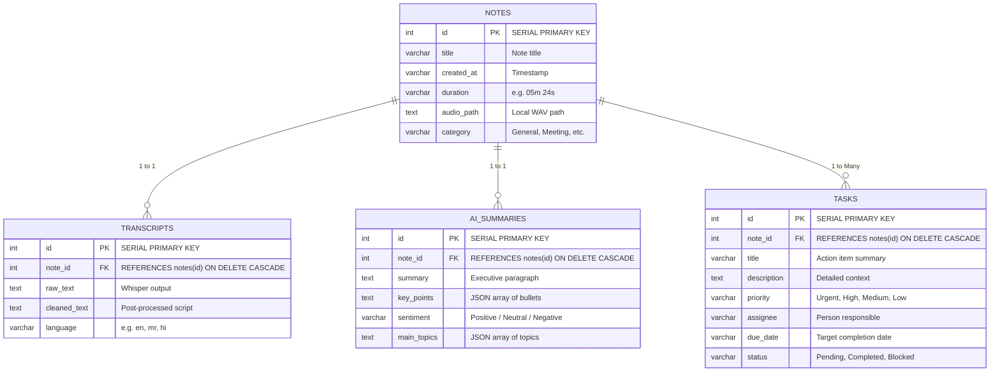

# VoiceNote: Intelligent Desktop Audio Intelligence & Semantic Retrieval System

VoiceNote is a privacy-first, offline-capable desktop application for recording audio, transcribing speech, repairing multilingual code-switched transcripts (e.g., Marathi/Hindi with English), extracting structured AI-generated insights, and enabling high-performance semantic search.

Developed by:
- **Tejas** — Architecture & Integration Lead
- **Samar** — UI/UX & System Integration Lead
- **Atharv** — AI Lead

---

## Document Index

- [Architecture Overview](doc/architecture.md)
- [Software Requirements Specification](doc/srs.md)
- [Implementation Plan](doc/implementation-plan.md)
- [Module Breakdown](doc/module-breakdown.md)
- [Database Setup Guide](doc/database-setup.md)

---

## Core Technology Stack

| Layer | Primary Technology | Purpose |
| :--- | :--- | :--- |
| **Frontend UI** | **PySide6 (Qt 6 for Python)** | Native desktop UI, 60 FPS waveform visualization, responsive layouts |
| **Concurrency** | **Qt QThread, Signal & Slot** | Non-blocking background worker pipeline |
| **Audio DSP** | **sounddevice, soundfile, pyaudiowpatch, numpy** | Audio capture, loopback recording, and real-time amplitude normalization |
| **Speech-to-Text (STT)** | **faster-whisper (CTranslate2) & Groq** | Local offline transcription & high-speed cloud STT |
| **AI & NLP** | **Google Gemini (google-genai) + Pydantic v2** | Structured summarization, task extraction, and linguistic error correction |
| **Relational Database** | **PostgreSQL (psycopg2-binary)** | ACID-compliant structured metadata, transcripts, and relational task tracking |
| **Vector Database** | **ChromaDB + sentence-transformers (all-MiniLM-L6-v2)** | 384-dimensional dense vector embeddings for cosine semantic retrieval |
| **Document Export** | **ReportLab & python-docx** | Formatted export to PDF, Word DOCX, and plain text |

---

## System Architecture Diagrams

### 1. High-Level Layered System Architecture

---

### 2. End-to-End Processing Pipeline (Audio to Insight)

---

### 3. Hybrid Dual-Database & Semantic Search RAG Flow

---

### 4. PostgreSQL Relational Database Schema (ER Diagram)

